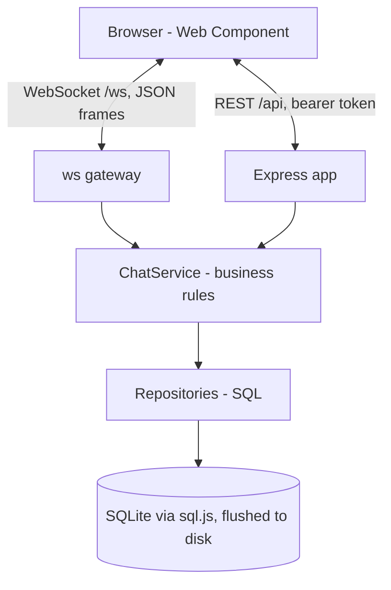

# NexusChat - Real-Time Messenger

[](https://github.com/codebyjuliamendes/realtime-chat/actions/workflows/ci.yml)
[](https://nodejs.org)
[](./LICENSE)

A real-time group chat built on raw WebSockets (`ws`), Express and SQLite (`sql.js`), with a
WhatsApp/Slack-inspired web client written as a vanilla Web Component styled with Tailwind CSS.

It is a single-node application meant as a solid, well-tested reference for the hard parts of
real-time messaging: identity on the socket, rooms, delivery/read acknowledgements, rate limiting,
backpressure, reconnection with catch-up and graceful shutdown.

---

## Features

- **Server-issued identities.** `POST /api/session` creates a user and returns an HMAC-signed
  session token. The WebSocket authenticates with that token, so a client can no longer claim
  someone else's user id.
- **Channels (rooms).** Public channels anyone signed in can create, join and search. Messages,
  typing indicators and read receipts are delivered only to sockets that joined the channel.
- **Acknowledged delivery.** Each message carries a client-generated UUID; the server stores it,
  acks it (`✓`) and broadcasts it. Retries with the same id are idempotent; reusing someone
  else's id is rejected. Read receipts (`✓✓`) can only be issued by other members.
- **Presence** with multi-tab support (you stay online while any tab is connected).
- **Resilient client.** Unlimited reconnection with jittered exponential backoff, an outbox
  that re-sends unacknowledged messages, and catch-up of missed messages after reconnecting.
- **Limits and abuse protection.** Max frame size, max message length, per-connection token
  bucket rate limit (repeat offenders are disconnected), HTTP write rate limit, authentication
  timeout, origin check on the WebSocket upgrade, slow-consumer protection.
- **Safe rendering.** All user content is inserted with `textContent`; a strict
  Content-Security-Policy (`script-src 'self'`, no CDNs) backs it up.
- **Operations.** Validated configuration, structured JSON logs (pino), `/healthz` and `/readyz`,
  graceful shutdown (closes sockets with `1001`, drains HTTP, flushes the database), Docker image
  running as non-root with `HEALTHCHECK`, Kubernetes manifests.
- **Accessible, responsive UI.** Labelled controls, visible focus, `role="log"` live region,
  loading/empty/error states, double-submit prevention, off-canvas sidebar on phones (tested at 390px).
- **Low-bandwidth hint.** The heartbeat measures ping/pong RTT; while a user's RTT is above
  500 ms, authenticated API responses carry `X-Low-Bandwidth: true`.
- **API docs** (OpenAPI) at `/api-docs`.

## Quick start

Requirements: Node.js 22+.

```bash
npm install
npm run dev        # builds the CSS and starts the server with --watch
```

Open <http://localhost:3003> in two different browsers (or a private window) and chat.

Production-like run with Docker:

```bash
SESSION_SECRET=$(openssl rand -hex 32) docker compose up --build
```

## Configuration

All settings are environment variables, validated at boot (the process exits with a clear
message when one is invalid). See [`.env.example`](./.env.example) for the full list.

| Variable                                        | Default            | Notes                                                                                                     |
| ----------------------------------------------- | ------------------ | --------------------------------------------------------------------------------------------------------- |
| `PORT` / `HOST`                                 | `3003` / `0.0.0.0` |                                                                                                           |
| `NODE_ENV`                                      | `development`      | `production` enables HSTS and requires `SESSION_SECRET`.                                                  |
| `SESSION_SECRET`                                | -                  | **Required in production**, at least 32 chars. In development one is generated in `data/.session-secret`. |
| `SESSION_TTL_SECONDS`                           | `2592000` (30d)    | Sliding: each WebSocket login returns a fresh token.                                                      |
| `DB_PATH`                                       | `./data/chat.db`   | `:memory:` for a throwaway database.                                                                      |
| `PERSIST_INTERVAL_MS`                           | `1000`             | Max delay before writes reach disk.                                                                       |
| `ALLOWED_ORIGINS`                               | empty              | Extra origins allowed for WebSocket/API (comma separated). Empty means same origin only.                  |
| `TRUST_PROXY`                                   | `false`            | Set `true` behind a reverse proxy so per-IP rate limits see the real client.                              |
| `WS_RATE_LIMIT_BURST` / `WS_RATE_LIMIT_PER_SEC` | `20` / `5`         | Token bucket per connection.                                                                              |
| `WS_MAX_PAYLOAD_BYTES`                          | `16384`            | Larger frames close the socket with `1009`.                                                               |
| `MESSAGE_MAX_LENGTH`                            | `2000`             | Characters. The web client also enforces 2000; keep them aligned.                                         |
| `WS_MAX_BUFFERED_BYTES`                         | `1048576`          | Per-socket send buffer before the client is treated as a slow consumer.                                   |
| `HTTP_WRITE_RATE_LIMIT_PER_MIN`                 | `20`               | `POST /api/session` and `POST /api/channels`, per IP.                                                     |
| `LOG_LEVEL`                                     | `info`             |                                                                                                           |

## Scripts

| Script                            | What it does                                                            |
| --------------------------------- | ----------------------------------------------------------------------- |
| `npm run dev`                     | Build CSS and run the server with `--watch`                             |
| `npm start`                       | Build CSS and run the server                                            |
| `npm run build:css` / `watch:css` | Compile Tailwind (`client/styles.css` -> `public/assets/app.css`)       |
| `npm test`                        | Unit + integration tests (`node:test`, real HTTP and WebSocket servers) |
| `npm run test:e2e`                | Browser test of the main flows with Playwright (needs Chromium)         |
| `npm run lint` / `format:check`   | ESLint / Prettier                                                       |
| `npm run typecheck`               | TypeScript `checkJs` over the server (JSDoc types)                      |
| `npm run check`                   | Lint + format + typecheck + tests                                       |

## Architecture



```text
server/
  index.js            process entry: config, signals, graceful shutdown
  server.js           composition root (used by tests too)
  config.js           env parsing and validation
  logger.js           pino logger
  domain/             pure, transport-agnostic code
    chat-service.js   rules: sessions, channels, idempotent messages, read receipts
    protocol.js       WebSocket frame parsing/validation, error and close codes
    validation.js     usernames, channel names, message content, ids
    session-token.js  HMAC-signed tokens
    rate-limiter.js   token bucket
    lru-cache.js      cache for channel lookups
  db/
    database.js       sql.js lifecycle, versioned migrations, atomic debounced persistence
    repositories.js   all SQL
  http/app.js         security headers, static files, REST API, health, errors
  ws/gateway.js       auth, rooms, rate limit, backpressure, presence, heartbeat
public/               static client (no build step except the CSS)
  components/chat-app.js, js/*.js, index.html, swagger.json
client/styles.css     Tailwind source
test/                 unit and integration tests
e2e/ui.e2e.mjs        Playwright flow test
```

### WebSocket protocol

Connect to `/ws` (the root path `/` is still accepted) and send `auth` within 5 seconds.
Every frame is `{ "type": string, "payload": object }`.

| Client -> server | Payload                            |
| ---------------- | ---------------------------------- |
| `auth`           | `{ token }`                        |
| `join` / `leave` | `{ channelId }`                    |
| `message`        | `{ id: UUID, channelId, content }` |
| `typing`         | `{ channelId }`                    |
| `message_read`   | `{ id, channelId }`                |

| Server -> client   | Payload                                                           |
| ------------------ | ----------------------------------------------------------------- |
| `auth_ack`         | `{ user, token }` (refreshed token)                               |
| `joined` / `left`  | `{ channelId }`                                                   |
| `message_ack`      | `{ id, channelId, status, timestamp, duplicate }`                 |
| `new_message`      | `{ id, channelId, userId, username, content, timestamp, status }` |
| `message_update`   | `{ id, channelId, status: 'read', readBy }`                       |
| `typing_indicator` | `{ userId, username, channelId }`                                 |
| `presence_update`  | `{ userId, username, status, lastSeen }`                          |
| `channel_created`  | `{ channel }`                                                     |
| `error`            | `{ code, message, ref? }` (`ref` = message id when relevant)      |

Close codes: `4001` invalid/expired session (do not reconnect), `4008` authentication timeout,
`1008` rate limit abuse, `1009` frame too large, `1001` server shutting down (reconnect).

### Design decisions and trade-offs

1. **`ws` instead of Socket.IO.** Full control over framing, limits and lifecycle; rooms,
   reconnection and acks are implemented explicitly (and tested) instead of hidden in a library.
2. **Stateless signed tokens, no passwords.** Joining only needs a display name, matching the
   original product. The token proves _which_ user you are; it is not an account system.
   Signing out removes the token from the browser but it stays valid until it expires (there is
   no server-side revocation list). Display names are not unique.
3. **SQLite through `sql.js` (WebAssembly).** Zero native dependencies and zero setup. The whole
   database lives in memory and is flushed atomically (temp file + rename) at most every
   `PERSIST_INTERVAL_MS`, instead of rewriting the file synchronously on every write as before.
   A crash can lose at most that window of writes.
4. **Light DOM Web Component.** Lets Tailwind utilities style the component. Tailwind is now
   compiled at build time instead of the Play CDN, so the CSP can forbid inline and remote scripts.

## Testing

- `npm test` runs 60+ tests in a few seconds: pure domain units (validation, tokens, protocol
  parser, rate limiter, LRU, backoff, config), database migrations/persistence, the HTTP API, and
  WebSocket integration tests against a real server: authentication and forged tokens, auth
  timeout, origin check, room isolation, idempotency and id conflicts, size limits, rate limit and
  disconnection, read-receipt authorization, multi-tab presence, slow-consumer termination and
  graceful shutdown.
- `npm run test:e2e` drives two browsers: login validation, XSS payloads in name and message,
  read receipts, typing, channel creation/unread badges/search, server restart with offline outbox
  and catch-up, 390px layout and the API docs page under the CSP.

## Deployment

- **Docker:** multi-stage image, non-root `node` user, `HEALTHCHECK` on `/healthz`, data in the
  `/data` volume. CI builds it and runs a smoke test (health, login, API, graceful stop).
- **Kubernetes:** `k8s/` contains a Deployment (1 replica, `Recreate`, PVC, probes on
  `/healthz` and `/readyz`, hardened security context), Service, Ingress with WebSocket timeouts and
  an example Secret. Create the secret first:
  `kubectl create secret generic realtime-chat --from-literal=session-secret="$(openssl rand -hex 32)"`.
- Serve it over HTTPS (TLS at the ingress/proxy) so the browser uses `wss://`.

## Limitations

- **Single instance.** State (SQLite file, rooms, presence) is in-process; do not run more than one
  replica. [SCALE.md](./SCALE.md) describes the path to horizontal scaling (Redis pub/sub,
  PostgreSQL); none of it is implemented here.
- All channels are public to signed-in users; there are no private channels or direct messages.
- Read status is per message (first reader marks it read), not per recipient.
- No message editing/deletion, attachments or push notifications.
- The UI is English-only and dark-only.

## License

[MIT](./LICENSE)
